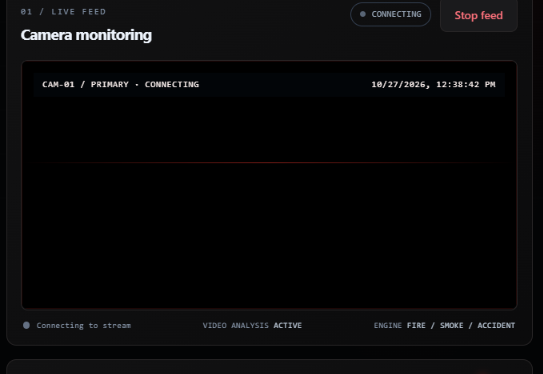
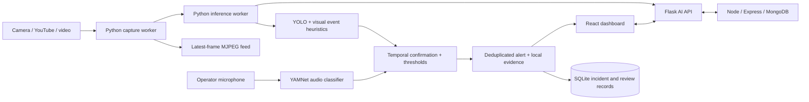

<p align="center">
  
</p>

<p align="center">
  <a href="https://github.com/amruthssss/multimodal-Surveillance-"></a>
  
  
  
</p>

<p align="center"><b>Local-first video and audio event monitoring with operator-reviewed alerts.</b></p>

---

## ◉ Mission

Sentinel Vision combines a React operations dashboard, a Node.js account/configuration API, and a Python computer-vision service. It accepts camera streams and recordings, analyzes visual and audio signals locally, and gives operators evidence to review before acting.

The project is a prototype. Its detections are advisory and need evaluation on representative clips before operational use.

## ✦ What it does

- **Connects video sources:** built-in camera, RTSP, IP camera, public YouTube stream, or local video file.
- **Analyzes visual events:** fire, smoke, traffic accidents, and explosion-like visual cues.
- **Analyzes audio events:** YAMNet classifies gunshot and explosion sounds when the operator enables microphone monitoring.
- **Displays an alert queue:** confirmed incidents include camera/source, event, severity, confidence, repeat count, and a locally saved image or audio sample.
- **Deduplicates and acknowledges incidents:** repeated detections update one incident for up to two minutes; higher severity escalates it. Operators can acknowledge alerts in the dashboard.
- **Learns from explicit review:** correct, false-alarm, and missed-event labels are saved and adjust per-event thresholds. This changes decision thresholds; it does not retrain neural-network weights.
- **Measures performance:** the Event Intelligence view reports reviewed-example precision/recall. An offline evaluator measures labeled video and audio clips.

## ⌁ Alerting and delivery

### Confirmation and incident handling

| Signal | Confirmation | Escalation |
| --- | --- | --- |
| Fire, smoke, accident | Event-specific confidence threshold and 2 matching results in the last 3 inference samples | Critical requires 3 matching samples and at least 85% confidence |
| Explosion in video | Same 2-of-3 confirmation; visual evidence is checked for the event | A strong fast path can mark critical at 95% only when at least 3 explosion cues agree; otherwise critical requires 3 samples |
| Gunshot/explosion audio | YAMNet event score ≥0.65 in one window, or ≥0.30 in two consecutive windows | Strong matches respond in one ~1-second analysis window; lower scores need temporal confirmation. Score ≥0.75 is critical; lower confirmed scores are high. |
| Repeated same event | Same camera and event are grouped for 120 seconds | One incident’s occurrence count and last-seen time are updated; higher severity replaces its risk and refreshes its evidence |

### Dashboard-first operator review

Every confirmed event is persisted and appears in the dashboard alert queue first. Each incident includes the event label, severity, camera or microphone source, first/last seen time, confidence, repeat count, and evidence. Video evidence is saved as a JPEG snapshot; audio evidence is saved as a WAV clip. Operators can preview/play the evidence and acknowledge the incident. Repeated detections for the same camera and event update that incident for 120 seconds; a severity increase escalates the existing incident and refreshes its evidence.

Example dashboard alert:

```text
FIRE · HIGH
Camera: camera_0 · Source: video
Time: 10/27/2026, 14:32:08 · Confidence: 91%
Occurrences: 4 · State: awaiting acknowledgement
Evidence: JPEG snapshot
```

Evidence stays under `data/alerts/` and is excluded from Git.

### External notification rules

Email and optional SMS use a private Flask-to-Node relay. For each event class, external delivery remains gated until at least 20 human-reviewed samples are available and measured precision is at least 90%. After that gate, confirmed HIGH/CRITICAL alerts can be emailed to the signed-in account address with the JPEG snapshot attached. SMS is opt-in and critical-only; the backend rejects every non-critical SMS. Delivery status and recent sent/failed attempts appear in Settings. Configure SMTP (and optionally Twilio) as described below. No provider credentials are committed.

## ◉ Product snapshots

The project banner above is animated. The screenshot below shows the camera monitoring view while a source is connecting; confirmed alerts display the saved snapshot or audio evidence in the dashboard.



## ▧ Architecture



## ◈ Models

| Capability | Current implementation | Notes |
| --- | --- | --- |
| General object context | YOLO26 Nano COCO checkpoint (`yolo26n.pt`) | Objects provide context; the COCO model is not an explosion classifier. |
| Fire/smoke | Optional YOLO event checkpoint plus visual heuristics | Configured through `FIRE_SMOKE_MODEL_REPO` / `FIRE_SMOKE_MODEL_FILE`; availability depends on model download or local weights. |
| Traffic accident | Optional YOLO accident checkpoint plus motion/vehicle context | Runs periodically to reduce inference load. |
| Video explosion | Temporal visual heuristics | No verified dedicated lightweight explosion checkpoint is bundled. |
| Gunshot/explosion audio | YAMNet ONNX and AudioSet class map | Microphone capture is opt-in. |

The model cards describe their authors’ datasets and results; those are not performance measurements for this app. No labeled evaluation set is bundled by default.

## ⌘ Run locally

### Requirements

- Windows 10/11 or a compatible desktop OS
- Python 3.12+
- Node.js 24+ and npm
- MongoDB for account/configuration services
- A webcam, supported network camera, or video/audio clips

### Configure

```powershell
git clone https://github.com/amruthssss/multimodal-Surveillance-.git
cd multimodal-Surveillance-
Copy-Item .env.example .env
```

Edit `.env`: set a unique `JWT_SECRET`, a `MONGODB_URI`, and any local model/source settings. URL-encode special characters in MongoDB passwords. Never commit `.env`, model weights, video, or alert evidence.

### Install

```powershell
python -m venv venv
.\venv\Scripts\Activate.ps1
python -m pip install --upgrade pip
python -m pip install -r requirements.txt

Push-Location surveillance-backend
npm install
Pop-Location
Push-Location surveillance-frontend
npm install
Pop-Location
```

For NVIDIA GPU inference, install the PyTorch/CUDA wheel matching the machine from the [official PyTorch selector](https://pytorch.org/get-started/locally/) before installing the remaining Python requirements.

### Start

Run all services from the repository root:

```powershell
.\START.bat
```

Or start each in its own terminal:

```powershell
# Python camera and AI API
.\venv\Scripts\Activate.ps1
python app.py

# Node account/configuration API
Push-Location surveillance-backend
npm start

# React dashboard
Push-Location surveillance-frontend
npm run dev
```

Open **http://127.0.0.1:4300**. The Python API uses port **5000**; the Node API uses **5001**. Configure a source in the dashboard to start video inference. Microphone monitoring is separately opt-in.

## ◎ Review detections and measure accuracy

The dashboard’s Event Intelligence page lets an operator label a detected event as correct or a false alarm, or label a normal sample as a missed event. Reviewed labels are stored in SQLite and appear in the evaluation cards. Threshold updates are stored in the ignored local file `data/detection_feedback.json`.

For a separate clip-level evaluation set, copy `evaluation/manifest.example.csv` to `evaluation/manifest.csv`, add labeled local media paths, then run:

```powershell
python scripts/evaluate_labeled_videos.py --manifest evaluation/manifest.csv --output evaluation/report.json
```

The manifest supports `normal`, `explosion`, `fire`, `smoke`, `accident`, and `gunshot`. Use `media_type=video` for visual events and `media_type=audio` for gunshot/audio-explosion clips. Include normal clips and keep a final evaluation set separate from clips used to tune thresholds. See [evaluation/README.md](evaluation/README.md).

## ⇄ API reference

| Endpoint | Purpose |
| --- | --- |
| `GET /health` | Python service health |
| `GET /api/status` | Camera and model state |
| `GET /api/detections/recent` | Latest per-camera detections |
| `GET /api/alerts` | Recent persisted incidents |
| `POST /api/alerts/{id}/acknowledge` | Acknowledge an incident |
| `GET /api/alerts/{id}/evidence` | View its local JPEG/WAV evidence |
| `POST /api/detections/feedback` | Persist an operator ground-truth label |
| `GET /api/detections/reviews` | Retrieve reviewed examples |
| `GET /api/detections/evaluation` | Calculate per-event precision, recall, and F1 |
| `POST /api/camera/configure` | Configure a video source |
| `POST /api/audio-analysis` | Analyze an opt-in microphone window |
| `GET /api/alerts/status` | Check SMTP/Twilio configuration for the signed-in account |
| `GET /api/alerts/deliveries` | Review recent outbound send results |

## ⚙ Configuration

| Variable | Purpose |
| --- | --- |
| `MONGODB_URI`, `JWT_SECRET` | Node API database and authentication |
| `FLASK_PORT`, `PORT` | Python and Node service ports |
| `VITE_API_URL`, `VITE_AI_URL` | Frontend API addresses |
| `VIDEO_SOURCE`, `FRAME_INTERVAL` | Camera device and inference sampling |
| `VIDEO_MAX_WIDTH`, `VIDEO_JPEG_QUALITY` | Stream bandwidth/quality balance |
| `EVENT_MODEL_INTERVAL` | Specialized visual model sampling interval |
| `FIRE_SMOKE_MODEL_REPO`, `TRAFFIC_ACCIDENT_MODEL_REPO`, `YAMNET_MODEL_REPO` | Optional Hugging Face model sources |
| `FIRE_SMOKE_CONFIDENCE`, `ACCIDENT_CONFIDENCE` | Event-model confidence cutoffs |
| `AUDIO_GUNSHOT_THRESHOLD`, `AUDIO_EXPLOSION_THRESHOLD` | Moderate audio scores requiring two consecutive windows |
| `AUDIO_GUNSHOT_STRONG_THRESHOLD`, `AUDIO_EXPLOSION_STRONG_THRESHOLD` | Strong one-window audio confirmation cutoff |
| `ALERT_DISPATCH_SECRET`, `ALERT_DISPATCH_URL` | Private Python-to-Node alert relay; keep the shared secret only in the ignored root `.env` |
| `SMTP_HOST`, `SMTP_PORT`, `SMTP_USER`, `SMTP_PASSWORD`, `SMTP_FROM` | SMTP provider for account email alerts with a JPEG snapshot attachment |
| `TWILIO_ACCOUNT_SID`, `TWILIO_AUTH_TOKEN`, `TWILIO_FROM` | Optional provider configuration for critical-only SMS |
| `DATABASE_URL` | SQLite event/review database or compatible SQLAlchemy URL |

See [.env.example](.env.example) for the complete local configuration template.

### Configure outbound delivery

1. Set a long random `ALERT_DISPATCH_SECRET` in the ignored root `.env` (for example, generate one with `python -c "import secrets; print(secrets.token_urlsafe(48))"`). Both services load this same file. The account API listens on localhost; the shared secret protects its internal dispatch endpoint.
2. For email, set `SMTP_HOST`, `SMTP_PORT`, `SMTP_SECURE`, `SMTP_USER`, `SMTP_PASSWORD`, and `SMTP_FROM`. For Gmail, use an app password with two-step verification enabled; never use or commit your normal account password.
3. Restart Flask and the Node account API. Sign in, open **Settings**, enable email, and save. Email goes to the account email on file once that event class clears the review gate.
4. For optional SMS, configure Twilio's account SID, auth token, and sender number. Enable **Critical SMS only** in Settings. The server rejects SMS for every non-critical event.
5. Review **Recent sends** in Settings to see sent/failed status. Missing credentials, an unmet accuracy gate, or a provider error leaves the incident in the dashboard and does not report a successful external send.

Email uses Nodemailer's SMTP transport ([provider setup reference](https://nodemailer.com/smtp/)); optional SMS uses Twilio's [Messages REST resource](https://www.twilio.com/docs/messaging/api/message-resource). Provider account charges and recipient policies apply.

Example email subject and body:

```text
[HIGH] fire · camera_0

Confirmed fire alert
Severity: HIGH
Camera: camera_0
Time: 10/27/2026, 14:32:08
Confidence: 91.0%
Repeated detections: 4
Accuracy gate: 24 reviewed samples, 91.7% precision
A JPEG evidence snapshot is attached.
```

Example SMS (critical incidents only):

```text
CRITICAL GUNSHOT · microphone · 96% · 10/27/2026, 14:32. Review: http://localhost:4300/dashboard
```

## ⛨ Privacy and limitations

- Services bind to localhost by default. Do not expose them to the public internet without authentication, access controls, and a reviewed deployment design.
- Video and audio evidence remain on the machine running the Python service unless an accuracy-qualified email alert is sent; that email includes the JPEG snapshot by design. External messages contain event metadata, and SMS contains no image attachment.
- Account tokens are stored by the browser application. Review the authentication and deployment model before using real accounts.
- A few reviewed events are not enough to establish accuracy. Track false positives and misses per event on representative day/night, indoor/outdoor, and camera conditions.
- This prototype is not a substitute for human judgment or certified life-safety systems. Do not rely on it as the only means of detecting emergencies.

## License

Check the licenses of the project and each downloaded model before redistribution or commercial use. Model weights are not included in this repository.
