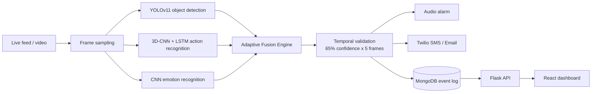

# Multimodal Surveillance System for Intelligent Security Monitoring

A real-time multimodal AI system that detects **fire, smoke, explosions, accidents, intrusion and fighting** from live camera feeds and video files. It combines object detection, action recognition and emotion recognition through an **Adaptive Fusion Engine**, validates detections over time to reduce false alarms, and raises alerts through audio alarms, SMS and email. Events are logged to MongoDB and shown on a live web dashboard.

> **Note:** This is the public version of the project. Trained model weights and learned pattern files are not included because of their size. See [Models](#models) for how to train or add your own.

---

## Features

- **Real-time detection** on live feeds and recorded video
- **Multimodal fusion:** YOLOv11 object detection, 3D-CNN + LSTM action recognition and CNN emotion recognition, combined by an Adaptive Fusion Engine
- **Temporal validation:** an alert fires only when confidence stays at or above **65% across 5 consecutive frames**, which suppresses single-frame false positives
- **Multi-channel alerting:** audio alarm, Twilio SMS and email notifications
- **Event logging:** every event is stored in MongoDB
- **Live dashboard:** Flask backend with a React frontend

### Detected events

| Event | Main cues |
|---|---|
| Fire | Flame colour analysis, flickering, sustained duration |
| Smoke | Gray coverage, slow drift, gradual increase |
| Explosion | Sudden bright flash, radial burst, short duration |
| Accident | Motion spike with vehicles detected, linear collision pattern |
| Intrusion | Person detection and action recognition |
| Fighting | Multiple people, irregular motion, sustained activity |

---

## System architecture



---

## Tech stack

| Area | Tools |
|---|---|
| Language | Python |
| Deep learning | PyTorch, YOLOv11 (Ultralytics), 3D-CNN, LSTM, CNN |
| Computer vision | OpenCV (optical flow, HSV colour segmentation) |
| Backend | Flask |
| Frontend | React |
| Database | MongoDB |
| Alerts | Twilio (SMS), email, audio alarm |

---

## Project structure

```
.
├── main.py                        # Command-line detection entry point
├── app.py                         # Flask application
├── enhanced_final_ultra_system.py # Core detection and fusion logic
├── smart_event_differentiator.py  # Separates similar events (e.g. accident vs explosion)
├── intelligent_event_logic.py     # Event rules and thresholds
├── train_yolov11.py               # YOLOv11 training script
├── test_trained_model.py          # Model testing
├── config/                        # Configuration
├── models/                        # Trained models (not included in public version)
├── services/  workers/  utils/    # Alerting, background workers, helpers
├── surveillance-backend/          # Backend service
├── surveillance-frontend/         # React dashboard source
├── requirements.txt
├── environment.yml
└── .env.example                   # Environment variable template
```

---

## Getting started

### Prerequisites

- Python 3.10+
- Node.js and npm (for the dashboard)
- MongoDB (local or Atlas)
- Twilio account (optional, for SMS alerts)

### 1. Clone and install

```bash
git clone https://github.com/amruthssss/multimodal-Surveillance-.git
cd multimodal-Surveillance-

python -m venv venv
# Windows: venv\Scripts\activate    |  macOS/Linux: source venv/bin/activate
pip install -r requirements.txt
```

Or with conda:

```bash
conda env create -f environment.yml
```

### 2. Configure environment

```bash
cp .env.example .env
```

Open `.env` and fill in your MongoDB connection string, Twilio credentials and email settings. Never commit this file.

### 3. Add a model

Place your trained YOLOv11 weights at:

```
runs/detect/train/weights/best.pt
```

or train your own (see [Models](#models)).

### 4. Run

**Command-line detection on a video:**

```bash
python main.py --video path/to/video.mp4
```

**Web dashboard:**

```bash
# Backend
python app.py

# Frontend (in a second terminal)
cd surveillance-frontend
npm install
npm start
```

On Windows you can also use the helper scripts: `EASY_SETUP.bat`, `START.bat` or `START_SERVERS.bat`.

---

## Models

### YOLOv11 detector

Trained on a custom 4-class dataset (fire, accident, fighting, explosion):

| Metric | Value |
|---|---|
| mAP@50 | 75.5% |
| Precision | 75.6% |
| Recall | 72.8% |
| Epochs | 130 |

To train your own model, prepare a dataset in YOLO format and run:

```bash
yolo train model=yolov11m.pt data=data.yaml epochs=130 imgsz=640
```

### Action and emotion recognition

The 3D-CNN + LSTM action recognizer and the CNN emotion recognizer feed their outputs into the Adaptive Fusion Engine alongside the YOLO detections.

---

## How it works

1. **Capture:** frames are read from a live feed or video file, with frame skipping to keep latency low.
2. **Detect:** YOLOv11 finds objects, the 3D-CNN + LSTM classifies actions across frame sequences, and the CNN classifies emotion.
3. **Fuse:** the Adaptive Fusion Engine merges the three signals into a single confidence score per event type.
4. **Validate:** an event is confirmed only after **5 consecutive frames at 65% confidence or higher**.
5. **Alert and log:** a confirmed event triggers the audio alarm, Twilio SMS and email, and is saved to MongoDB.
6. **Display:** the Flask API serves events to the React dashboard in real time.

### Tuning thresholds

Detection thresholds and the streak requirement live in `enhanced_final_ultra_system.py`:

```python
self.streak_requirement = 5   # consecutive frames needed to confirm an alert
```

---

## Responsible use

This system is intended for safety and security monitoring. Make sure your deployment complies with local privacy and surveillance laws and with the consent requirements that apply to the areas being monitored.

## License

This project is for educational and research purposes.

## Author

**Amruth S Sharma**

- GitHub: [@amruthssss](https://github.com/amruthssss)
- LinkedIn: [amruths604](https://linkedin.com/in/amruths604)
- Portfolio: [amruthssharmaportfolio.netlify.app](https://amruthssharmaportfolio.netlify.app/)
