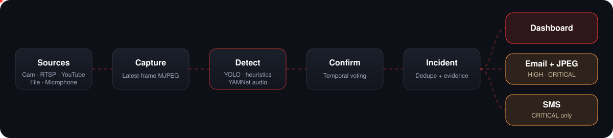
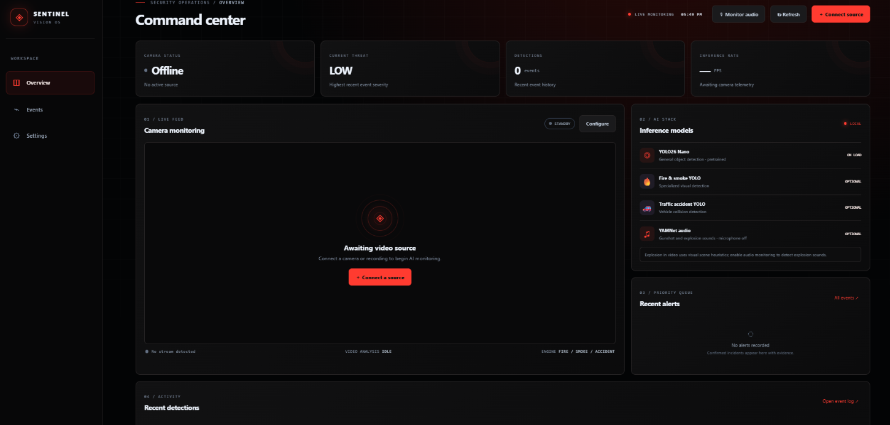
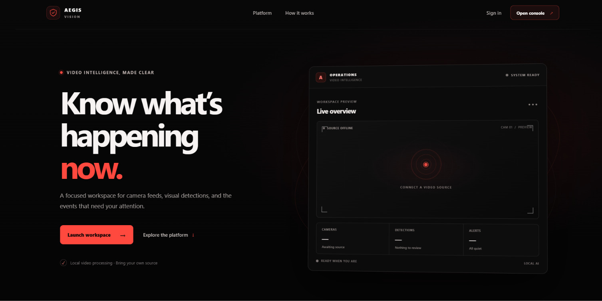
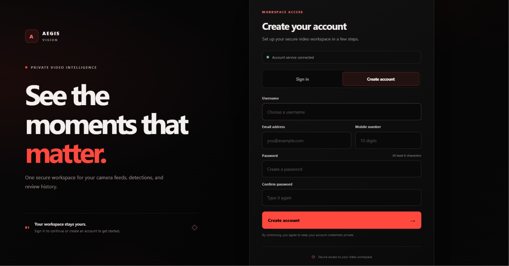

<p align="center">
  
</p>

<p align="center">
  
  
  
  
</p>

<p align="center"><b>Local-first video and audio event monitoring with operator-reviewed alerts.</b></p>

---

## Overview

Sentinel Vision combines a React dashboard, a Node.js account/configuration API, and a Python computer-vision service. Connect camera streams or recordings, review detections, and inspect incident evidence before acting. This is a prototype; validate it with representative footage and keep a human in the loop.

<p align="center"></p>

## Detection capabilities

<p align="center"></p>

- **Video:** fire, smoke, traffic accident, and explosion-like visual cues.
- **Audio:** gunshot and explosion sounds with opt-in microphone monitoring.
- **Sources:** webcam, RTSP/IP camera, YouTube stream, or local media file.
- **Review:** confirm or reject detections; feedback adjusts event thresholds, not neural-network weights.

## Alerts

| Event | Confirmation | Critical escalation |
| --- | --- | --- |
| Fire, smoke, accident | Event threshold in 2 of 3 inference samples | 3 matching samples at ≥85% confidence |
| Video explosion | 2 of 3 samples with visual cues | 3 samples, or ≥95% with 3+ agreeing cues |
| Audio gunshot/explosion | YAMNet score ≥0.65 once or ≥0.30 twice consecutively | Score ≥0.75 |
| Repeated event | Grouped by camera and event for 120 seconds | Severity increase updates the existing incident |

Confirmed incidents appear in the dashboard with source, time, confidence, severity, repeat count, and evidence. Video evidence is a JPEG snapshot; audio evidence is a WAV clip. Evidence is stored locally in ignored `data/alerts/`.

Email is optional for HIGH/CRITICAL alerts. SMS is optional and critical-only. Both require at least **20 reviewed examples per event class** and **90% measured precision** for that class. These are delivery gates, not a claim that the project has achieved those results. Provider credentials must be configured before messages can be sent.

<details>
<summary><b>Example notification format</b></summary>

```text
[HIGH] fire · camera_0
Time: {event_time} · Confidence: {confidence}
Reviewed examples: {count} · Measured precision: {precision}
JPEG evidence attached
```

```text
CRITICAL GUNSHOT · microphone · {confidence} · {event_time}
Review: {dashboard_url}
```

</details>

## Models

| Capability | Implementation |
| --- | --- |
| General object context | YOLO26 Nano (`yolo26n.pt`) |
| Fire/smoke | Optional YOLO checkpoint plus visual heuristics |
| Traffic accident | Optional YOLO checkpoint plus motion/vehicle context |
| Video explosion | Temporal visual cues; no dedicated checkpoint bundled |
| Audio | YAMNet ONNX with AudioSet classes |

Optional weights may download on first use; model scores are not app accuracy measurements. No labeled evaluation set is included by default.

## Screenshots



The supplied landing and account screenshots use **Aegis Vision** branding and are included as visual references, not captures of the current Sentinel Vision pages.

<details>
<summary><b>Supplied visual references</b></summary>




</details>

## Run locally

**Requirements:** Windows 10/11, Python 3.12+, Node.js 24+, MongoDB, and a camera or media clips.

```powershell
git clone https://github.com/amruthssss/multimodal-Surveillance-.git
cd multimodal-Surveillance-
Copy-Item .env.example .env  # set JWT_SECRET and MONGODB_URI

python -m venv venv
.\venv\Scripts\Activate.ps1
python -m pip install -r requirements.txt

Push-Location surveillance-backend; npm install; Pop-Location
Push-Location surveillance-frontend; npm install; Pop-Location

.\START.bat
```

Open **http://127.0.0.1:4300** and connect a source. Services can also be started separately: `python app.py` (AI API, port 5000), `npm start` in `surveillance-backend` (port 5001), and `npm run dev` in `surveillance-frontend` (port 4300).

## Review and evaluate

Use **Event Intelligence** to label correct detections, false alarms, and missed events. To evaluate labeled clips, copy `evaluation/manifest.example.csv` to `evaluation/manifest.csv`, add local paths, then run:

```powershell
python scripts/evaluate_labeled_videos.py --manifest evaluation/manifest.csv --output evaluation/report.json
```

Labels: `normal`, `explosion`, `fire`, `smoke`, `accident`, `gunshot`. See [evaluation/README.md](evaluation/README.md).

## Configure external delivery

Set `ALERT_DISPATCH_SECRET` in the ignored root `.env` and configure SMTP values (`SMTP_HOST`, `SMTP_PORT`, `SMTP_USER`, `SMTP_PASSWORD`, `SMTP_FROM`). For SMS, add `TWILIO_ACCOUNT_SID`, `TWILIO_AUTH_TOKEN`, and `TWILIO_FROM`. Restart Flask and Node, then enable email or **Critical SMS only** under **Settings**. Check **Recent sends** for delivery results. Missing credentials, an unmet accuracy gate, or provider errors leave the alert in the dashboard.

Email uses [Nodemailer SMTP](https://nodemailer.com/smtp/); SMS uses [Twilio Messages](https://www.twilio.com/docs/messaging/api/message-resource). Provider charges may apply. Never commit `.env` or provider credentials.

<details>
<summary><b>API and configuration</b></summary>

| Endpoint | Purpose |
| --- | --- |
| `GET /health`, `GET /api/status` | Service health and camera/model state |
| `GET /api/alerts` | Incident list |
| `POST /api/alerts/{id}/acknowledge` | Acknowledge incident |
| `GET /api/alerts/{id}/evidence` | JPEG/WAV evidence |
| `POST /api/detections/feedback` | Save operator label |
| `GET /api/detections/evaluation` | Per-event precision, recall, F1 |
| `GET /api/alerts/status`, `/api/alerts/deliveries` | Delivery configuration and recent sends |

See [.env.example](.env.example) for configuration variables.

</details>

## Privacy and limitations

- Services bind to localhost by default; review authentication and access controls before remote exposure.
- Evidence stays on the Python service except JPEGs attached to qualified email alerts; SMS contains metadata only.
- Detections are advisory and are not a substitute for human judgment or certified life-safety systems.
- Check this project and model licenses before redistribution or commercial use. Model weights are not included.
